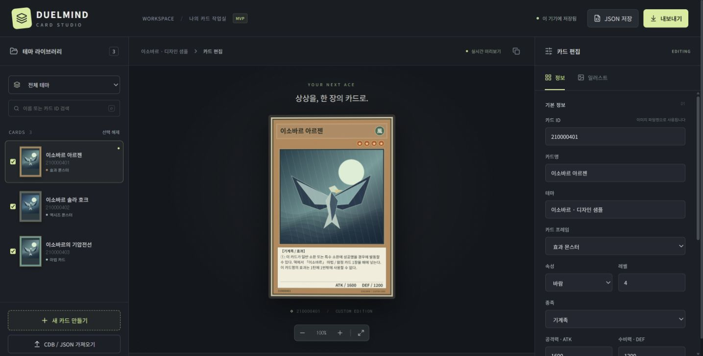

# DUELMIND CARD STUDIO

React + TypeScript + Vite로 만든 브라우저 전용 커스텀 카드 이미지 제작기.
카드 효과의 Lua 구현이나 기존 EDOPro 설치본 수정은 하지 않습니다.

실행 사이트: https://bduidohd937-beep.github.io/ygocardmaker/



## 실행

Node.js 24 권장.

```powershell
npm ci
npm run dev
npm test
npm run build
```

`npm run dev`가 표시한 로컬 주소를 엽니다. 배포 결과물은 dist/입니다.
GitHub Pages는 main push 시 `.github/workflows/pages.yml`로 테스트·빌드·배포합니다.
Vercel에서도 build `npm run build`, output `dist`로 정적 배포할 수 있습니다.

## 사용

1. 카드 목록에서 선택하거나 새 카드를 만듭니다. 테마 필드로 카드를 묶습니다.
2. 카드 종류와 스탯·효과를 입력하고 일러스트 탭에서 PNG/JPG/WebP를 업로드합니다.
3. CDB/JSON 가져오기로 카드 메타데이터를 채웁니다. 동일 ID의 기존 일러스트와 위치는 유지됩니다.
4. JSON 저장으로 프로젝트를 백업합니다. 파일 안에 이미지도 포함됩니다.
5. 출력 체크박스를 선택하고 내보내기에서 PNG/JPG 또는 ZIP을 받습니다.

지원: 일반/효과/토큰/의식/융합/싱크로/엑시즈/링크/마법/함정, 링크 마커,
6종 몬스터 펜듈럼, 한국어 자동 줄바꿈·글자 크기 조정, 일러스트 크롭,
테마 필터·검색·복제, IndexedDB 자동 저장.

ZIP 구조:

```text
pics/210000401.png         # 421 × 614
originals/210000401.png    # 1263 × 1842, 전체 카드 고화질
manifest.json             # ID·이름·테마·파일 경로·크기
```

JPG를 선택하면 두 이미지 폴더 모두 .jpg를 사용합니다.
단일 다운로드는 421×614, 842×1228, 1263×1842를 선택할 수 있습니다.
모든 파일명은 카드 ID입니다. 실제 EDOPro 표시 검증은 별도입니다.

## 오버프레임 카드 제작

카드 선택 → **일러스트** 탭 → **오버프레임 03**에서 사용합니다.

1. 배경으로 사용할 일반 일러스트를 업로드합니다.
2. 인물·드래곤 등 **배경을 제거한 투명 PNG**를 돌출 레이어로 업로드합니다. (10MB 이하 / 4000만 픽셀 이하)
3. **프레임 돌출 사용** 체크 후 가로·세로 이동, 크기(25~300%), 회전(-45~45°)을 조절합니다.
4. 미리보기에서 확인하고 PNG/JPG/ZIP으로 출력합니다. 기존 421×614, 1263×1842 출력 규격을 사용합니다.

일러스트 경계를 가로지르는 돌출 레이어는 카드명·랭크·효과창을 보호하는 영역 안에 합성됩니다.
PNG 투명도는 그대로 사용하며 **자동 배경 제거/수동 브러시 마스킹은 아직 지원하지 않습니다.**
이미지와 위치 설정은 기존 프로젝트 JSON 백업과 IndexedDB 자동 저장에 포함되고,
동일 카드 ID의 CDB 메타데이터를 다시 가져와도 보존됩니다.
돌출 PNG가 없는 기존 카드는 종전과 똑같이 렌더링됩니다.

## 토큰 카드 제작

- 카드 프레임에서 `토큰`을 선택하면 `[종족 / 토큰]`이 표시됩니다. 펜듈럼 및 일반 몬스터 특성은 토큰에 적용하지 않습니다.
- 리소스 ZIP에 `card-token.png`가 있다면 전용 프레임을 사용하며, 없으면 기본 토큰 색상으로 대체 렌더링합니다.
- CDB **가져오기**에서 `TYPE_MONSTER | TYPE_NORMAL | TYPE_TOKEN` (`0x4011`)을 토큰 카드로 인식합니다.
- JSON 저장·불러오기, PNG/JPG 카드 이미지·ZIP 출력은 기존 기능을 사용합니다. 이 앱은 현재 CDB 파일을 **내보내는 기능은 제공하지 않습니다.**
- 토큰 카드는 효과로 생성되는 카드로 메인 덱에 직접 넣지 않습니다.

## 가져오기와 데이터 보존

- JSON은 프로젝트의 `{version:1, name, cards:[...]}` 또는 EDOPro cards.json 배열을 지원합니다.
- CDB는 datas/texts를 sql.js/WASM으로 브라우저 안에서 읽습니다. 파일을 서버로 전송하지 않습니다.
- 외부 이미지 URL은 가져오지 않습니다. 이미지는 PNG/JPEG/WebP data URI로 보존합니다.
- 메타데이터 병합은 ID 기준입니다. 기존 일러스트가 있으면 이미지·확대·위치를 보호합니다.
- 잘못된 ID/중복 ID는 거부합니다. 이미지 누락·링크 마커 수·스케일·지원하지 않는 설정은 출력 검사에서 확인합니다.
- 초기 3장은 디자인 샘플이며 확정 게임 효과/ID가 아닙니다. 실제 카드 정보는 따로 가져오세요.
- 저장은 브라우저/주소별입니다. 로컬과 배포 사이트는 저장소가 다릅니다. JSON으로 이동하세요.

## 범위와 제한

공식 카드 프레임·로고·상업 폰트를 복제하지 않은 자체 Canvas 프레임입니다.
글이 최소 크기에도 맞지 않으면 출력 오류를 표시하며 텍스트를 잘라 출력하지 않습니다.
매우 긴 카드명은 축소합니다. 특수 튜너/리버스 등 미지원 표기는 확인 경고가 필요합니다.
토큰·공식 홀로그램·희귀도·완전한 공식 인쇄 자형은 아직 지원하지 않습니다.
Undo/카드 삭제/클라우드 동기화는 MVP 범위에 포함하지 않습니다.
큰 프로젝트는 JSON과 ZIP 생성 시 브라우저 메모리를 사용합니다. 중요한 작업은 JSON 백업하세요.

## 자산과 출처

현재 프레임과 샘플 일러스트는 자체 도형/Canvas 코드로 제작했습니다.
UI 아이콘은 Lucide(ISC), 한국어 글꼴은 Noto Sans KR(SIL OFL 1.1)입니다.
폰트 허가문은 public/licenses/NotoSansKR-OFL.txt에 포함합니다.
React·fflate·sql.js 등의 의존성은 각 패키지의 라이선스를 따릅니다.

요청한 외부 카드 리소스는 [조사 보고서](resources/README.md),
[적용 계획](resources/INTEGRATION.md), [파일별 목록](resources/catalog.json)에 정리했습니다.
검토용 외부 이미지와 폰트는 resources/review-only/에만 있으며 Git과 배포에서 제외됩니다.
현재 렌더러에 연결하지 않았습니다.


## 3:4 오버프레임 간편 제작 (V3)

카드를 선택하고 **일러스트 → 3:4 간편 모드 열기**를 누릅니다.

1. 처음부터 3:4로 완성된 카드용 원화 하나를 업로드합니다 (PNG/JPG/WebP, 10MB 이하).
2. 카드명·속성·효과창을 각각 켜거나 끕니다. 효과창은 비운 채 테두리만 남기거나 텍스트를 표시할 수 있습니다.
3. 효과창 스타일(반투명 흑색/베이지/테두리), 불투명도, 높이와 위치를 변경합니다.
4. **3:4 PNG 다운로드**를 누르면 **1500×2000** 고화질 파일을 카드 ID 이름으로 출력합니다.
5. **설정 저장**으로 카드별 원화·표시 옵션을 프로젝트/JSON에 저장합니다.

전경을 복제하지 않으며 배경 제거/마스크가 필요하지 않습니다. 기존 OCG 카드용 PNG/JPG/ZIP 기능과 정밀 오버프레임 모드는 그대로 유지됩니다.
이 간편 모드의 독립 PNG는 3:4 포스터형 출력이므로 EDOPro의 421×614 카드 이미지 규격과 다릅니다.


### 간편 모드의 폰트·속성·별 에셋
3:4 간편 모드는 별도 제작 원형/문자 대신 **기존 카드 프레임 ZIP의 리소스**를 사용합니다.
카드명은 `ygo-kr-name.woff2`, 속성은 `attribute-*-kr.png`,
일반 몬스터 레벨은 `level.png`, 엑시즈 랭크는 `rank.png`를 사용합니다.
효과 텍스트를 표시하면 `ygo-kr.woff2`를 사용합니다.
해당 리소스가 없으면 임의 스타일을 그리지 않고 누락된 에셋명을 안내합니다.
카드 종류·레벨/랭크 값은 간편 모드에서 설정할 수 있으며, 기존 카드 정보에도 저장됩니다.
*이미지 원화 자체에 이름·아이콘·별이 포함되어 있다면 이 모드에서 추가한 에셋과 중복됩니다.
따라서 배경 원화는 텍스트나 카드 장식이 없는 이미지를 권장합니다.*

## 카드 편집 탭 구성

- **정보**: 카드명·속성·레벨/랭크·효과 및 기타 카드 정보
- **일러스트**: 일반 카드 원화 업로드, 크롭, 확대와 위치 조정
- **오버프레임**: 3:4 단일 원화 간편 제작, 기존 투명 PNG 돌출·마스크 정밀 편집

오버프레임 기능은 일러스트 탭에서 독립 탭으로 이동했으며, 이미 저장한 카드별 원화·마스크·설정은 그대로 유지합니다.


### 오버프레임 카드명 배경 설정 (V3.2)

오버프레임 탭 → **3:4 간편 모드 열기** → **카드명 배경**에서 선택합니다.

- **없음 (기본값)**: 기존 상단 검정 그라데이션을 제거하고, 원화 위에 기존 카드명 폰트의 얇은 외곽선만 표시합니다.
- **글자 그림자만 강조**: 배경을 덮지 않고 카드명 글자에만 그림자를 추가합니다.
- **상단 검정 그라데이션**: 이전 V3 버전의 상단 검은 바탕을 명시적으로 선택한 경우에만 표시합니다.

기존에 저장된 프로젝트에 이 설정이 없더라도 기본적으로 상단 배경은 나타나지 않습니다. 원본 카드명·속성·레벨/랭크 아이콘·효과창 설정은 그대로 유지됩니다.


### 오버프레임 자유 배치 V3.3

**카드 렌더러 → 오버프레임 → 3:4 간편 모드**에서 카드명·속성·레벨/랭크 별·효과창을 직접 선택하고 드래그합니다. 선택한 테두리의 우하단을 드래그하면 크기가 바뀌며, 오른쪽 **자유 배치 에디터**에서 X/Y 좌표와 크기를 숫자로 조절할 수 있습니다. 가운데/여백 정렬 스냅을 끌 수도 있습니다.

**레이아웃 프리셋**에서 기본 OCG형·중앙 일러스트형·하단 효과창형을 적용하거나, 현재 배치를 이름 붙여 최대 5개까지 카드 자체에 저장합니다. 프리셋과 편집 좌표는 900×1200 기준으로 JSON에 저장되고 900×1200 미리보기와 1500×2000 PNG 출력 모두 같은 렌더러를 사용합니다. 편집 가이드·핸들 테두리는 PNG에 포함되지 않습니다.

이전 버전의 간편 오버프레임 데이터에 위치 정보가 없어도 종전 기본 위치를 그대로 사용합니다.

### 3:4 오버프레임 V3.4 — OCG풍 효과창

**오버프레임 → 3:4 간편 모드 → 05 · 효과창 디자인**에서 아래를 편집합니다.

- 정교한 **OCG풍 효과창**(새 카드의 기본값) / 기존 반투명 흑색·베이지·테두리만
- 카드 종류에 따라 자동 색감 선택, 또는 차콜·자수정·은회색·청회색·고동색 직접 선택
- 이중/단일/없음 테두리, 테두리 두께, 은은한 종이 질감 강도
- 종족·융합/싱크로/엑시즈/링크 등 유형 표기 ON/OFF (자산팩 `font:type` 필요)
- ATK/DEF 또는 ATK/LINK 표기 ON/OFF, 글꼴 크기 조절 (자산팩 `font:body` 필요)
- 효과 텍스트가 효과창을 초과하면 글자를 잘라내지 않고 오류를 표시합니다

기존 카드의 `glass`·`classic`·`outline` 스타일과 위치 설정은 그대로 유지합니다. 원화·속성·레벨/랭크 PNG는 변경하지 않으며 출력 1500×2000 PNG는 미리보기와 동일한 렌더러를 사용합니다. 이 효과창은 **OCG풍 커스텀 디자인**이며 기존 원본 카드의 텍스처를 그대로 복제한다고 주장하지 않습니다.


### 오버프레임 V3.5 — 연출 프리셋

**오버프레임 → 3:4 간편 모드 → 06 · 오버프레임 광택·홀로그램**에서 사용합니다.

- 기본값은 **연출 없음(OFF)**입니다. 이전 카드가 갑자기 반짝거리거나 어두워지지 않습니다.
- **엑시즈 흑요석 / 융합 자수정 / 싱크로 백은 / 링크 청록 / 범용 프리즘** 정적 광택을 선택합니다.
- 연출 강도 0~100%, 사용 ON/OFF, 현재 카드 종류에 맞는 추천을 지원합니다.
- 기본 프리셋 5개 외에 사용자 지정 연출 프리셋을 카드당 최대 5개까지 저장·복원·삭제할 수 있습니다.
- **연출 초기화**는 원화와 카드명/속성/랭크/레벨·V3.3 레이아웃·V3.4 효과창·기존 프리셋을 그대로 두고 광택만 OFF로 바꿉니다.
- 미리보기 900×1200과 PNG 1500×2000은 같은 원화 레이어 합성 경로를 사용합니다. 인쇄용 정적 광택이며 실제 움직이는 홀로그램은 아닙니다.

과도한 발광·그물형 선 장식·검은 상단 덮개를 만들지 않고, 좁은 대각 반사광과 얇은 외곽광만 사용합니다. 생성하는 것은 카드 일러스트가 아니라 기존 원화 위의 선택적 시각효과입니다.

## 오버프레임 V3.6 — 여러 장 일괄 제작·ZIP 출력

**카드 렌더러 → 오버프레임 → 여러 장 일괄 제작·ZIP 출력**을 선택합니다.

1. CDB 또는 JSON으로 카드를 먼저 불러온 뒤 최대 **100장**을 선택합니다.
2. `918760001.png` 또는 `918760001_원화.png`처럼 카드 ID로 이름 붙인 PNG/JPG/WebP 파일들을 한꺼번에 선택하거나 ZIP 묶음을 올립니다.
3. 파일명과 카드 ID를 정확히 대조하고, 중복 ID·누락 원화·원본 카드 에셋 누락을 보고합니다. 원화는 기본적으로 이 창에서만 임시 보관하며 **선택 카드에 원화·설정 저장**을 눌러야 프로젝트 데이터가 변경됩니다.
4. 기본값은 **카드별 기존 레이아웃/광택 유지**입니다. 필요하면 기본형·중앙형·하단형 레이아웃, 카드 종류에 맞는 광택을 일괄 적용합니다. 카드별 개별 수정은 기존 3:4 간편 모드를 사용합니다.
5. 8장씩 실제 렌더링된 미리보기를 보고 출력합니다. 폰트·속성·레벨/랭크 에셋이 없다면 해당 카드는 건너뛰고 ZIP 안의 오류 보고서에 남깁니다.

ZIP 출력 항목:
- `고화질_3대4/<카드ID>.png` — 1500×2000 원본 비율 고화질
- `pics/<카드ID>.png` — EDOPro 421×614 이미지
- `제작내역.json`, `누락_및_오류.txt` — 처리 카드 ID, 생성 경로, 제외 항목 등

EDOPro용 비율은 고화질 3:4와 다르므로 **중앙 자르기** 또는 **위아래 여백 추가**를 고를 수 있습니다. 원화를 한 방향으로 늘려 찌그러뜨리지는 않습니다. 일반 카드의 CDB/Lua·일러스트·정밀 마스크는 변경하지 않습니다.

용량 안전을 위해 한 번에 최대 100개 원화 파일(이미지당 10MB, 합계 120MB, ZIP 80MB)을 처리하며, 큰 묶음은 여러 번 나누어 출력하도록 권장합니다.


## 오버프레임 V3.7 — 카드별 레이아웃 추천

**카드 렌더러 → 오버프레임 → 3:4 간편 모드 → 07 · 카드별 레이아웃 자동 추천**

- 카드명, 카드 종류·랭크/레벨, 효과문 길이와 효과창 공간에 따라 **기본 OCG형 / 중앙 일러스트형 / 하단 효과창형**의 우선순위를 정합니다.
- 3:4 원화를 업로드하면 해당 원화에서 실제로 보일 영역을 180×240으로 축소한 후 **밝기·윤곽선 밀도**를 로컬에서 측정합니다. 인물·사물·얼굴을 인식하거나 외부 AI 서비스로 전송하지 않습니다.
- 후보별 실제 카드 합성 미리보기를 제공하며 **'이 레이아웃 적용'**을 눌러야 편집창에 반영됩니다. 이 단계에서도 원본 프로젝트에는 저장되지 않고 **'설정 저장'**을 눌러야 저장됩니다.
- 추천 적용 직후 **되돌리기** 버튼으로 직전 레이아웃을 복원할 수 있습니다. 이전 V3.3 수동 배치, V3.4 효과창과 V3.5 광택, 기존 자산팩은 변경되지 않습니다.
- **V3.6 일괄 제작**에는 `카드 정보 기준 자동 추천 배치`를 추가했습니다. 일괄 기능은 빠른 처리와 메모리 사용을 고려해 **원화 픽셀은 분석하지 않고** 카드 종류와 효과문 길이를 기준으로 순위를 결정합니다. 카드마다 원화 구도까지 반영하려면 개별 편집창을 사용하세요.

추천 지표는 디자인을 보조하는 **결정적 휴리스틱**이며 정답이나 이미지 품질 평가 점수가 아닙니다. 기존 프로젝트는 추천 기능을 실행하지 않는 한 영향을 받지 않습니다.


## V3.8 — 일반 카드 ↔ 3:4 오버프레임 비교·전환

**카드 렌더러 작업실 → 미리보기 위 ‘나란히 비교·출력’** 또는 **오버프레임 → 일반 카드·오버프레임 비교 열기**를 선택합니다.

- 일반 카드는 기존 842×1228 카드 렌더러(일반 일러스트, 정밀 오버프레임 포함)를 사용합니다. 3:4 오버프레임은 별도 단일 원화 900×1200 렌더러를 사용합니다. **일반 원화와 오버프레임 원화는 서로 덮어쓰지 않습니다.**
- 두 이미지를 독립적으로 실제 렌더링해 나란히 비교하고 하나를 선택하여 **‘선택한 형태를 기본 미리보기로 저장’**할 수 있습니다. 메인 작업실 상단에서도 즉시 전환할 수 있으며 카드별 선택은 프로젝트 JSON에 보존됩니다. 기존 프로젝트에는 기본값 일반 카드가 적용됩니다.
- 일반 카드가 없는 경우 일반 출력만 막고, 3:4 원화가 없다면 오버프레임 출력만 막습니다. 선택한 모드의 자산팩 누락도 별도 안내합니다.
- **고화질 PNG:** 일반 카드 1263×1842 / 오버프레임 1500×2000
- **EDOPro PNG:** 두 형태 모두 421×614. 일반 카드는 기존 규격으로 바로 렌더링, 3:4 오버프레임은 **중앙 자르기 / 여백 추가** 중 선택하여 원화의 가로·세로 비율을 늘리거나 찌그러뜨리지 않습니다.
- **비교 ZIP:** 두 이미지가 모두 있을 때 일반/오버프레임 폴더에 각각 출력하고 `비교_출력내역.json`을 첨부합니다.

이 기능은 V3.6 일괄 제작, V3.7 카드별 추천, V3.3 자유 배치, V3.4 효과창, V3.5 광택 및 원본 카드명·속성·레벨/랭크 에셋을 유지합니다. 카드 이미지를 자동으로 서로 변환하는 기능이 아니라 두 독립적 디자인을 비교·선택하는 기능입니다.


## YGO STUDIO V4.0 — 통합 카드 제작 작업실

작업실 최상단의 **통합 작업실 V4.0** 버튼에서 카드 제작을 네 단계로 일관되게 진행할 수 있습니다.

1. **카드·CDB**: 기존 카드 목록을 검색/선택하고 CDB·JSON 가져오기, 원본 에셋 ZIP 불러오기, 프로젝트 전체 JSON 백업을 처리합니다. 같은 카드 ID로 정보가 갱신돼도 기존 일반/3:4 원화와 편집 설정이 유지됩니다.
2. **이미지 관리**: `카드ID.png`, `카드ID_원화.jpg` 등의 파일명 또는 이미지 ZIP으로 카드 ID를 매칭합니다. 업로드 때 **일반 카드 일러스트와 3:4 오버프레임 원화를 명시적으로 구분**하며 한쪽 원화를 올려도 다른쪽은 변경하지 않습니다. 기존 이미지 덮어쓰기는 기본 OFF입니다. 매칭 결과와 적용 예정/미선택/기존 보호 건수를 미리 보여준 뒤, **선택한 카드에 이미지 적용**을 눌러야 프로젝트가 변경됩니다. 이미지는 컴퓨터의 원본 파일이 아니라 브라우저 작업 프로젝트에 저장됩니다.
3. **디자인 검수**: 기존 일반 카드 편집, 3:4 간편 오버프레임, 두 형태 비교, V3.6 일괄 오버프레임 제작 화면으로 이동합니다. 기존 OCG 원본 카드 에셋을 재사용하며 별도 가짜 속성·레벨 아이콘을 만들지 않습니다.
4. **통합 출력**: 선택 카드 최대 100장에 대해 일반/3:4/두 형태, 고화질/EDOPro 421×614, 3:4 자르기/여백 추가 방식을 선택합니다. 고화질은 `고화질_일반/ID.png`(1263×1842)·`고화질_오버프레임/ID.png`(1500×2000)입니다. EDOPro 단독 출력은 복사하기 쉬운 `pics/ID.png`, 두 형태를 동시에 출력할 때는 충돌 없이 `EDOPro_일반/pics/ID.png`·`EDOPro_오버프레임/pics/ID.png`로 분리합니다. 누락이 있으면 가능한 카드만 생성하고 ZIP에 `제작_검수보고서.json`과 `누락_및_오류.txt`를 동봉합니다.

규모 제한: 한 번에 카드 최대 100장, 이미지 ZIP 등의 용량은 기존 V3.6 제한, 출력 ZIP 이미지 합계 240MB. 브라우저 처리 중에는 진행 상태와 출력 취소를 지원합니다. 기존 CDB/Lua 파일을 수정하거나 엔진을 실행하지 않습니다. 기존 V3.3~V3.8의 일반·정밀 오버프레임, 배치 프리셋, 수동 배치, 원화 편집 및 고화질 개별 출력도 그대로 보존됩니다.


## YGO STUDIO V4.1 — 사전 제작 검수·가져오기 오류 수정

**통합 작업실 V4.0 → 04 출력**에서 선택된 카드의 제작 가능 상태를 **V4.1 출력 전 자동 검수표**로 확인할 수 있습니다. 카드별로 일반 카드/3:4 오버프레임 출력 준비 여부와 누락 원인을 보여주며, **문제 수정** 버튼으로 카드 편집, 이미지 연결 또는 원본 카드 에셋 불러오기 단계에 이동할 수 있습니다.

- **미완성 카드만 선택**: 선택한 출력 조합 중 하나라도 누락된 카드를 작업 대상으로 남깁니다. 이미 준비된 이미지는 삭제하지 않습니다.
- **출력 가능 카드만 선택**: 선택한 출력 조합에서 적어도 하나의 이미지를 만들 수 있는 카드만 남깁니다. 일반 카드+3:4 동시 출력 모드에서 한쪽만 준비된 카드도 포함되어 준비된 이미지는 출력하고 누락 항목은 ZIP 보고서에 남깁니다.
- **검수표 JSON 다운로드**: 선택한 카드와 요청한 이미지 유형에 대한 준비 상태, 오류 사유, 출력 가능/누락 수를 한글 파일명 JSON으로 내보냅니다.
- 검수는 원화·카드 메타데이터·저장 설정·원본 속성/글꼴 에셋 존재 여부를 확인하는 **사전 검사**입니다. 최종 PNG 렌더링 중 발생하는 오류는 ZIP 내부 **제작_검수보고서.json**과 **누락_및_오류.txt**로 따로 기록합니다.
- 통합 작업실에서 CDB/JSON 및 카드 에셋 ZIP 가져오기에 실패하면 **성공 메시지를 표시하지 않고 오류 사유를 보여줍니다**. CDB/JSON 파일 가져오기에 성공하면 가져온 카드 중 최대 100장을 통합 작업 대상으로 자동 선택하고 이미지 연결 단계로 이동합니다. 기존 이미지와 카드 데이터 보호 규칙은 동일합니다.

기존 V4.0, V3.3~V3.8 원화·레이아웃·광택·EDOPro ZIP, CDB/Lua 원본은 그대로 유지됩니다.

## YGO STUDIO V4.2 — 실전 제작 안정화

**통합 작업실 V4.2 → 04 출력**에서 다음 사항을 확인할 수 있습니다.

- **검수/출력 일치:** V4.1의 카드 메타데이터 검사를 실제 통합 ZIP 출력에도 적용합니다. 카드명·속성·종족·LINK 마커 등 오류가 있는 출력을 검수표에서 정상으로 표시하거나 ZIP에서 임의로 성공 처리하지 않습니다.
- **형태별 오류 격리:** 일반 카드가 정상이고 3:4 설정만 잘못된 경우 일반 카드 파일은 출력하고, 실패한 3:4 파일은 누락 보고서에 기록합니다. 반대 상황도 마찬가지입니다.
- **선택적 안전 오류 수정:** 선택한 카드 중 중복 몬스터 특성·중복 링크 마커(숫자 보존 시)·없는 원화를 가리키는 기본 미리보기 설정 등 수정이 명확한 항목만 화면에 목록을 표시합니다. **안전 오류 수정 적용** 버튼을 눌러야 브라우저 프로젝트에 변경이 반영됩니다. 카드명·효과문·스탯·원화·CDB·Lua는 자동 변경하지 않습니다.
- **ZIP 압축 개선:** 다수 카드 이미지 생성 이후 압축을 비동기 실행합니다. 취소 요청과 출력 크기 제한(240MB)을 압축 완료 전후에 확인하며, 최종 검수보고서에 `preflight_version: 4.2`를 기록합니다.
- **테스트 강화:** Vitest에서 ZIP 파일의 카드 ID 매칭, JSON 병합 시 기존 원화 보존, 메타데이터 오류 차단, 일부 성공/일부 실패, 최대 100장 ZIP 경로와 취소 처리를 검증합니다. 이 테스트는 렌더러 대신 테스트용 PNG 데이터를 사용합니다.
- **Chromium 실사용 검증:** GitHub Actions `browser-check.yml`에서 Playwright가 실제 SQLite CDB를 생성해 업로드하고, 원화 PNG ZIP 연결·원화 저장·EDOPro 421×614 PNG ZIP 다운로드·보고서 확인까지 수행합니다. 손상 CDB/ZIP 실패 처리도 검증합니다. 단, 3:4 오버프레임의 모든 디자인 프리셋을 실제 브라우저에서 렌더링 검증한 것은 아닙니다.

사람이 관리하는 다운로드 파일명은 `카드_통합출력_V4.2.zip`, `카드_출력전_검수표_V4.2.json`을 사용합니다. ZIP 내부의 카드 이미지 파일은 기존과 동일하게 **카드 ID.png**로 유지합니다.
